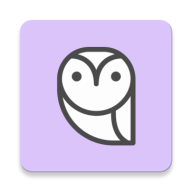
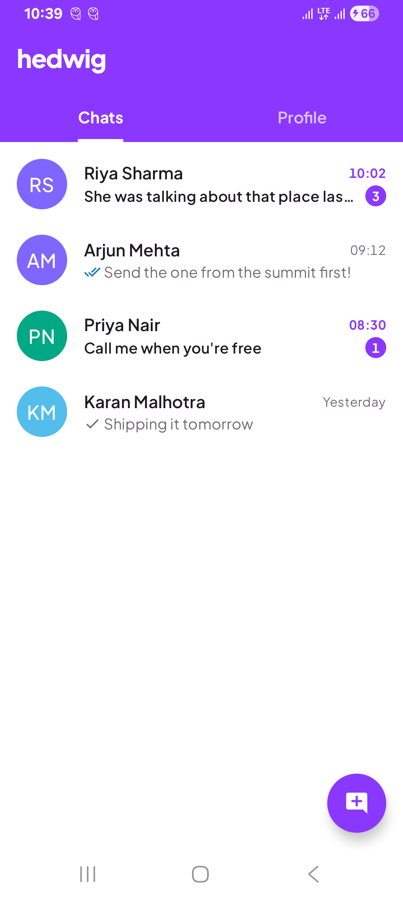
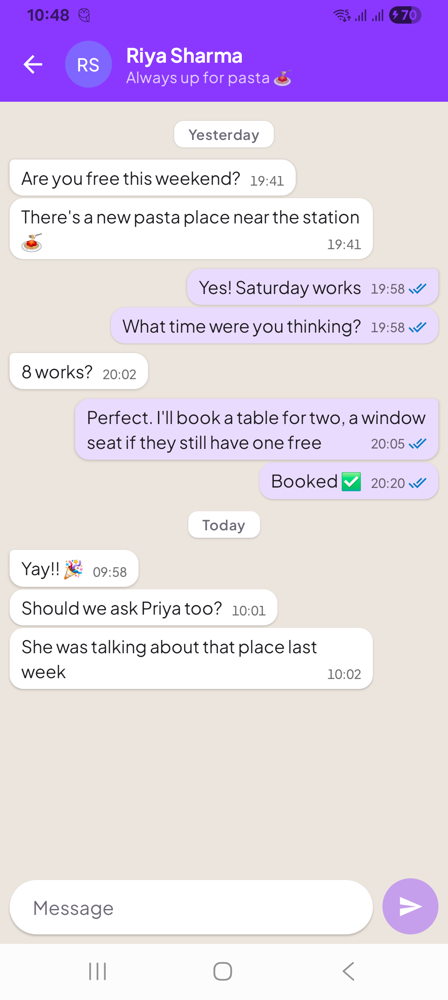
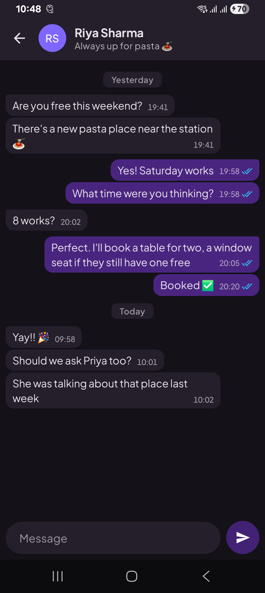
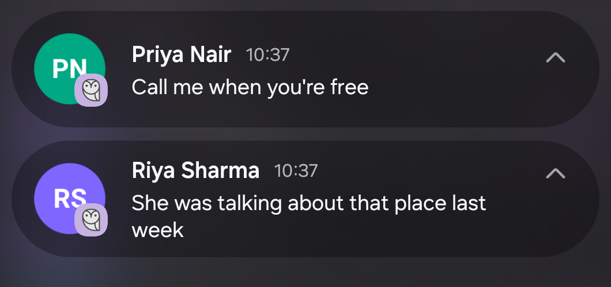
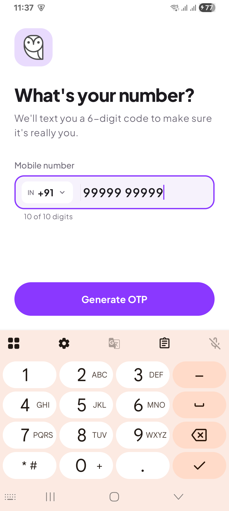
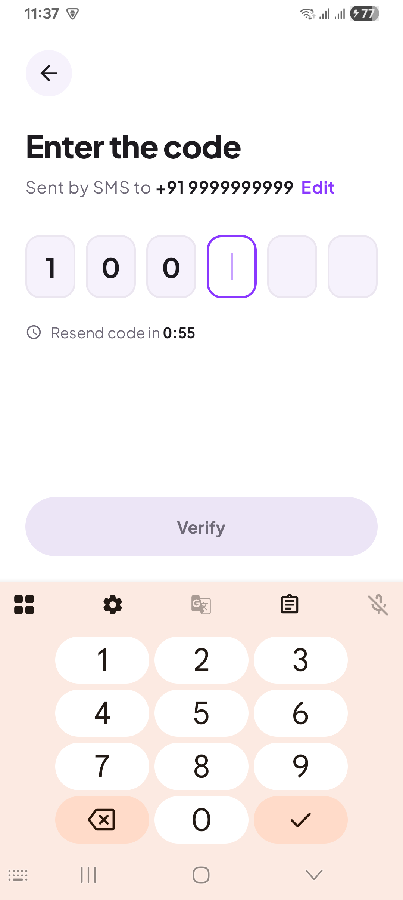
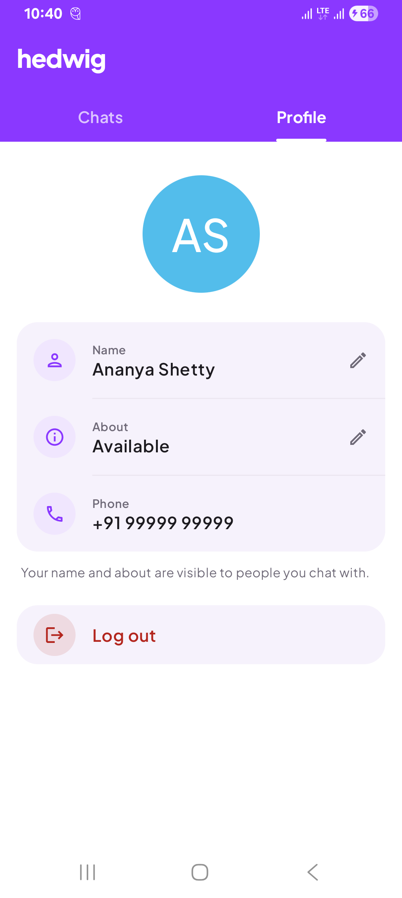
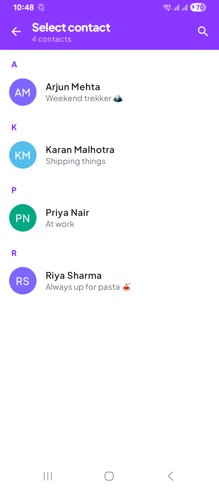

<p align="center">
  
</p>

<h1 align="center">hedwig</h1>

<p align="center">
  
</p>

<p align="center">
  A real-time one-to-one messaging app for Android, built with <b>Jetpack Compose</b>, <b>Firebase</b> and <b>Dagger 2</b>.
</p>

### Chatting live: messages, read receipts turning blue, a notification

https://github.com/user-attachments/assets/7ba41ed3-6138-4c20-b159-9b38a55c8102

### Phone sign-in

https://github.com/user-attachments/assets/b3f9f370-fdac-4cdf-925e-cd150489a71e

| Chats | Conversation | Dark | Notifications |
|:---:|:---:|:---:|:---:|
|  |  |  |  |

| Sign in | Verify | Profile | New chat |
|:---:|:---:|:---:|:---:|
|  |  |  |  |

## Features

- **Phone sign-in:** Firebase phone auth with a formatted number field, six OTP boxes that auto-submit, a resend countdown, and a pre-filled profile for returning users.
- **Real-time chat:**
  - **Sending:** messages appear instantly (optimistic send) and queue while offline.
  - **Layout:**
    - day headers ("Today", "Yesterday")
    - grouped bubbles with a sender-side tail
    - the time tucked into the last line of the bubble (a custom `Layout`)
    - a jump-to-newest button
- **Read receipts:** 🕓 sending, ✓ delivered to the server, ✓✓ read. All three come from one unread counter per user, with no per-message writes.
- **Chats list:** live ordering with animated reordering, unread badges, a tick on your own last message, and shimmer loading.
- **Notifications with no server:**
  - conversation-style (`MessagingStyle`), with the sender's avatar
  - one notification per chat
  - a tap opens that chat
  - cleared once the chat is read, on any device
- **Contacts:** A–Z sticky headers, search with highlighted matches, and an invite button using the share sheet.
- **Polish:**
  - light and dark themes, edge to edge
  - TalkBack support: merged bubble semantics, day headers as headings, plural-aware descriptions
  - layouts that grow with large font sizes
- **A web client on the same backend:** a companion browser client talks to the same Firestore project, so Android and web users chat with each other. The demo video uses it to play the other person.

## Tech stack

| | |
|---|---|
| Language | Kotlin 2.4, coroutines and `Flow` |
| UI | Jetpack Compose (BOM 2026.09), Material 3, custom layouts, Compose previews |
| Navigation | Navigation Compose 2.10 with type-safe `@Serializable` routes |
| Architecture | MVVM, unidirectional data flow, `StateFlow` UI state |
| Dependency injection | Dagger 2 with KSP: component dependencies and a per-screen scope |
| Backend | Firebase Authentication (phone), Cloud Firestore (real-time listeners, batched writes) |
| Platform | Notifications (`MessagingStyle`, channels, runtime permission), long-lived shortcuts, edge to edge |
| Build | AGP 9.4, version catalog, minSdk 26, targetSdk 37 |

## Architecture

```
            snapshot listeners                 combine → StateFlow<UiState>
Firestore ───────────────────────▶ Repositories ───────────────────────────▶ ViewModels ──▶ Compose screens
    ▲                              (callbackFlow)                                                │
    └──────────── batched writes: send, mark as read ◀──────────── events: send, open chat ◀─────┘
```

- **Repositories** wrap Firestore listeners in `callbackFlow` and expose plain `Flow`s. Writes are atomic batches.
- **ViewModels:**
  - `combine` several flows (profile, chat summary, messages) into a single immutable `UiState`
  - shape it for the screen: day headers, grouping, tick status
  - expose it with `stateIn(WhileSubscribed(5_000))`
- **Screens** come in two parts:
  - a thin `XxxScreen` that gets the ViewModel and collects its state with the lifecycle
  - a stateless `XxxContent` that takes plain values and is previewed in light, dark and edge cases
- **Dependency injection** uses three Dagger components:
  - **`ApplicationComponent`** (`@Singleton`): Firebase, the repositories, the notification classes
  - **`ActivityComponent`**: `MainActivity`
  - **`ScreenComponent`** (`@ScreenScope`): creates each ViewModel in its navigation destination's `ViewModelStore`, with a `SavedStateHandle` holding the route's arguments

```
dev.ajaykotian.hedwig
├── data/          model (User, Chat, Message) and repositories (Auth, User, Chat)
├── di/            components, modules, scopes, qualifiers
├── notification/  MessageNotifier, NotificationHelper, ActiveChatTracker
└── ui/            one package per screen (login, profile, home, chats, newchat, chat),
                   plus navigation, shared components and the theme
```

## Data model

```
users/{uid}                          phoneNumber, name, about
chats/{uidA_uidB}                    participants, lastMessage, lastMessageTime, lastSenderId, unread: {uid: count}
chats/{uidA_uidB}/messages/{autoId}  senderId, text, timestamp
```

- **The chat id is the two uids, sorted and joined.** Both people can find a chat without a lookup, and the security rules check membership from the id alone.
- **One batch per message:** it adds the message and updates the chat summary (last message, time, the receiver's `unread` incremented by one). The Chats list reads only the summaries.
- **Read receipts:**
  - If the other person's unread count is N, your last N messages show ✓ and everything older shows ✓✓.
  - Opening a chat resets your own count to 0.
  - A message that hasn't reached the server yet (`hasPendingWrites`) shows 🕓.
- **Timestamps** use `serverTimestamp()`. While a write is still local, they're read with `ServerTimestampBehavior.ESTIMATE`, so a just-sent message sorts correctly before the server confirms it.
- **The Chats list is sorted on the device.** Firestore would need a composite index to combine `array-contains` with `orderBy` on another field.
- **Security rules** are in [`firestore.rules`](firestore.rules):
  - Profiles are readable by any signed-in user, but writable only by their owner.
  - Chats and messages are readable only by the two participants.
  - A message can only be sent as yourself.

## Notifications without a server

hedwig runs on Firebase's free **Spark plan**, which doesn't include Cloud Functions, so nothing on the server can push to a phone. Instead:

1. **A listener in the app:** an application-scoped `MessageNotifier` keeps a Firestore listener on the user's chats for as long as the app's process is alive. It restarts per user with `collectLatest`, so signing out stops it.
2. **Detecting new messages:**
   - When a chat's last message changes and it's from the other person, the app posts a local conversation notification.
   - It skips the first snapshot, which is history.
   - It skips the chat that's currently on screen, tracked by `ActiveChatTracker` from the screen's lifecycle.
3. **Tapping a notification:** a `PendingIntent` opens `MainActivity` (`singleTop` and `onNewIntent`), and the nav host navigates to the chat.

**The limitation:** once Android kills the app's process, no notifications arrive until the app is opened again.

**The upgrade path:** on the Blaze plan, a Cloud Function triggered when a message document is created would send a Firebase Cloud Messaging (FCM) data message to the receiver's device token, stored on their user document. The existing `NotificationHelper` could display it unchanged.

## Design process

Every screen was built twice:
1. A functional pass with plain Material components, to get the data flow right.
2. A polish pass against mocks designed for it.

The mocks, and the reasoning behind each design decision, are in [`mockups/`](mockups/). There's one folder per screen, each with a README.

## Getting started

1. **Clone the repo** and open it in a recent Android Studio (AGP 9.4).
2. **Create a Firebase project** and add an Android app with the package name `dev.ajaykotian.hedwig`. Download its `google-services.json` into `app/`. The file is git-ignored.
3. **Enable phone sign-in:** Authentication → Sign-in method → **Phone**.
   - Add your debug key's SHA-1 and SHA-256 fingerprints (`./gradlew signingReport`) to the Firebase app. Phone auth needs them to verify the app.
   - For emulators and demos, add **test phone numbers** with fixed codes. No SMS is sent for those.
4. **Create a Cloud Firestore database** and publish the rules from [`firestore.rules`](firestore.rules).
5. **Run the app.** To chat, you need a second user: a second device or emulator signed in with another number.

## Credits

- App icon: <a href="https://www.flaticon.com/free-icons/owl" title="owl icons">Owl icons created by deemakdaksina - Flaticon</a>
- Font: <a href="https://github.com/tokotype/PlusJakartaSans" title="Plus Jakarta Sans">Plus Jakarta Sans</a> by Tokotype, licensed under the <a href="https://openfontlicense.org">SIL Open Font License 1.1</a>

## License

MIT. See [LICENSE](LICENSE).
