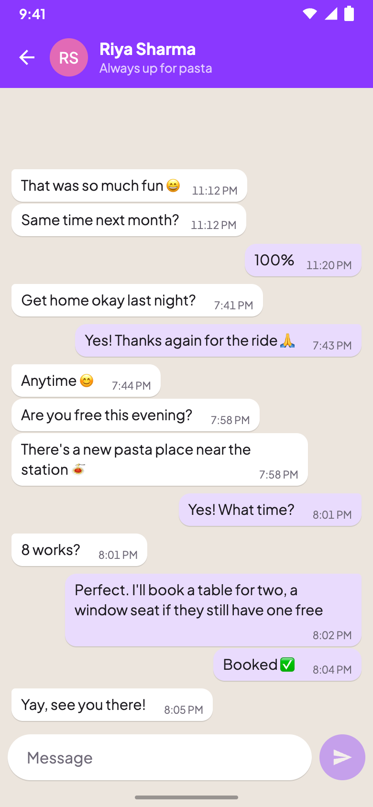
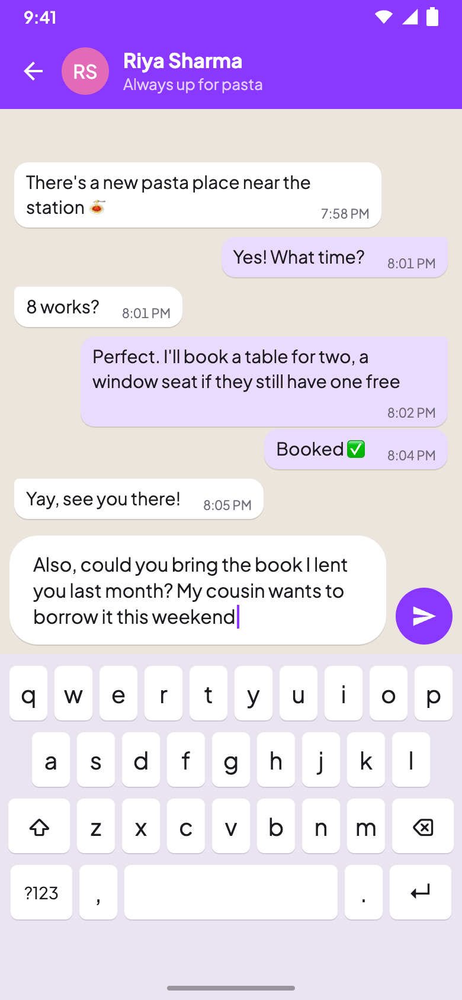
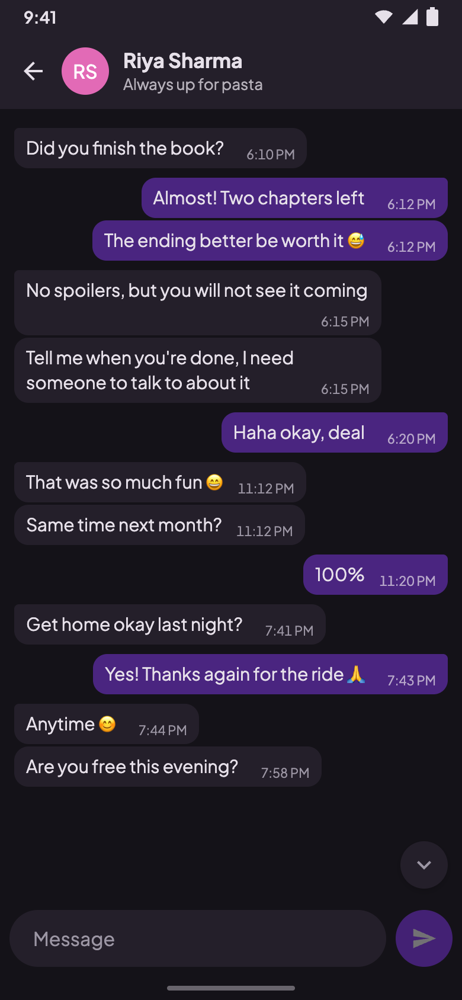
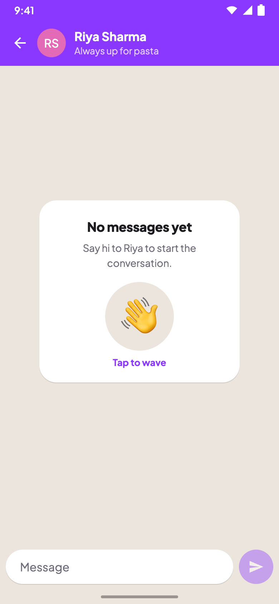
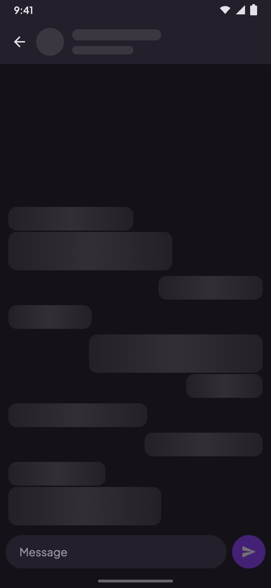
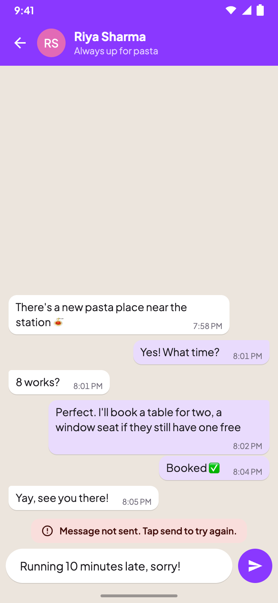
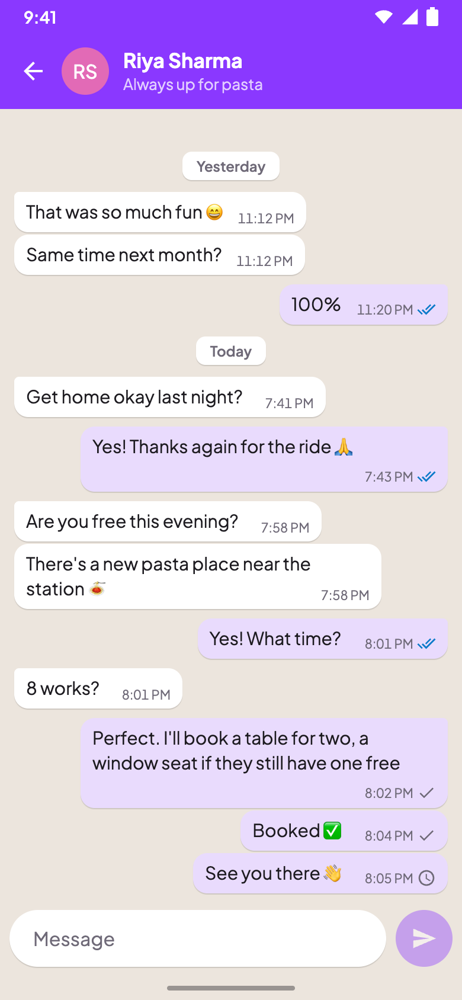
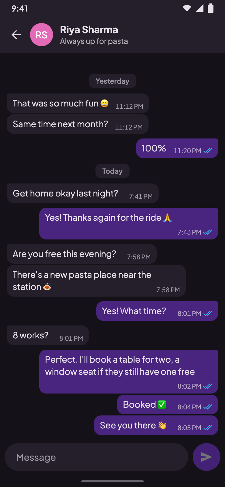

# Chat mockups

Target design for the one-to-one chat screen (Phase 9a UI polish). Phone frame: 390×844, rendered at 2x.
Colors come from `ui/theme/Color.kt`, and the font is Plus Jakarta Sans. The bubble language matches hedwig-web's chat pane, so both clients look like one product.
Mocks 1–6 are the Phase 9a polish. Mocks 7–8 add the Phase 9b/9c polish: day headers and ✓ ticks.

| # | Image | State |
|---|-------|-------|
| 1 | [01-conversation-light.png](01-conversation-light.png) | A conversation, at the newest message (light) |
| 2 | [02-typing-light.png](02-typing-light.png) | Typing a long message, keyboard open (light) |
| 3 | [03-scrolled-dark.png](03-scrolled-dark.png) | Scrolled up into history (dark) |
| 4 | [04-empty-light.png](04-empty-light.png) | No messages yet (light) |
| 5 | [05-loading-dark.png](05-loading-dark.png) | Waiting for the first snapshot (dark) |
| 6 | [06-send-error-light.png](06-send-error-light.png) | A send was rejected (light) |
| 7 | [07-day-headers-light.png](07-day-headers-light.png) | Day headers; sent and pending ticks (light) |
| 8 | [08-read-dark.png](08-read-dark.png) | The same chat after Riya read it (dark) |

## 1. Conversation



- **Top bar:** the back arrow, then a 40dp `Avatar`, then the name (17sp Bold) over the other user's about (13sp, 75% `onTopBar`). Both lines are single and ellipsized.
  - The about is the only "status" hedwig has. There's no online or last-seen presence.
- **Bubbles:** 12dp corners, text at 15sp / 21sp line height.
  - outgoing: `outgoingBubble`, aligned right
  - incoming: `incomingBubble`, aligned left
  - In light mode the bubbles have a 1dp shadow, so white bubbles separate from the wallpaper. Dark mode has no shadow.
- **Grouping:** consecutive messages from the same sender form a group.
  - **Gaps:** 2dp inside a group, 8dp between groups.
  - **Corner:** the first bubble of a group gets a 4dp corner at the top, on the sender's side: top-right for yours, top-left for theirs. It points at who sent the run of messages. The others keep all four 12dp corners.
- **Width:** a 56dp gap on the far side keeps a bubble from spanning the whole screen.
- **Time inside the bubble:** 11sp, tabular digits, `secondaryText` (70% `TextDark` on the dark outgoing purple), placed at the bottom-right.
  - **It fits on the last line:** it sits there, as in "8 works?" or "station 🍝".
  - **The last line is too full:** the time drops to a line of its own, as in "…if they still have one free".
  - Doing this in Compose needs a small **custom `Layout`**, because the bubble has to know how wide the text's *last line* is.
- **The list anchors to the bottom.** It's still the reversed `LazyColumn`, so a short chat sits just above the composer.
- **Composer:** no bar behind it. It floats on the wallpaper, like WhatsApp on Android.
  - **Field:** a pill (24dp corners, at least 48dp tall) in `field` with the light shadow, and no underline. Text is 16sp, with the placeholder "Message" in `secondaryText`.
  - **Send:** a 48dp `accent` circle. At 40% opacity while the field is blank, so it reads as disabled.

## 2. Typing



- **Growing field:** the field grows to 5 lines and then scrolls inside. The pill corners stay 24dp.
- **Send:** stays at the **bottom** of the row (`Alignment.Bottom`), next to the line being typed.
- **Keyboard:** `navigationBarsPadding().imePadding()` lifts the composer, and the list shrinks from the bottom, so "Yay, see you there!" stays visible. That's the functional pass's behaviour, unchanged.
- **Send active:** full opacity once there's text.

## 3. Scrolled up (dark)



- **Jump to newest:** a 40dp circle in `incomingBubble` with `KeyboardArrowDown`, 12dp from the right edge, above the composer.
  - **When it shows:** only while the newest message is out of view. It fades and scales in and out with `AnimatedVisibility`.
  - **Tap:** animates to the newest message.
  - **Why `derivedStateOf`:** the "is the newest out of view?" check reads `firstVisibleItemIndex`, which changes on every scroll frame. `derivedStateOf` turns it into a Boolean, so the button only recomposes when that answer flips.
- **New dark tokens:**
  - `chatBackground` → `BackgroundDark` `#141218`
  - `incomingBubble` → `SurfaceHighDark` `#241F2A`, the same as the top bar and the composer field
  - The old values (`#0B141A`, `#232D36`) are WhatsApp's blue slates. They clash with hedwig's purple-tinted dark neutrals, the same problem fixed for the top bar in Phase 6.
  - `ChatBackgroundDark` and `DarkSlate200` become unused, so delete them.
  - hedwig-web's dark `--chat-bg` and `--bubble-in` should follow.
- **Outgoing bubble:** `#4A2580` (`HedwigPurpleDark`), unchanged, with `TextDark` on it.

## 4. No messages yet



- **A card, not the bare `EmptyState`:** on the wallpaper, centred grey text gets lost, so the content sits on an `incomingBubble` card with 24dp corners, at most 280dp wide.
- **Copy:** the title "No messages yet" (18sp ExtraBold) and the line "Say hi to Riya to start the conversation." The name falls back to "them" while it's blank.
- **The wave is an action:** a 96dp circle in `chatBackground` with a 52sp 👋, above the label "Tap to wave" in `accentText`.
  - Tapping it **sends "👋"**, so a new chat starts with one tap.
  - It's a real emoji `Text`, not an icon.
- **Composer:** still there and usable. Typing works as usual.

## 5. Loading (dark)



- **Skeleton bubbles:** the same `Shimmer` as the other screens. Bones in bubble shapes, 12dp corners, with varied widths and some two-line heights, alternating sides like a real conversation. It replaces the spinner.
- **Top bar:** shimmer bones for the avatar, the name and the about, until the other user's profile arrives.
- **Composer stays usable:** the user can start typing before the history loads, and sending works anyway.

## 6. Send error



- **When it happens:** a send fails only when Firestore **rejects** it, for example because of the rules. Offline sends don't fail; they queue.
  - On rejection, the bubble disappears (Firestore rolls the local write back) and the ViewModel puts the text back into the field.
- **Pill:** `errorContainer` / `onErrorContainer` with an error icon, centred above the composer, 12dp corners, 13sp SemiBold. A plain `ErrorRow` would be hard to read on the wallpaper.
- **Copy:** "Message not sent. Tap send to try again." The send button is active, because the text is back.
- **It clears** on the next send, as it does now.

## 7. Day headers and ticks (light)



- **Day header:** a chip, not bare text, so it stays readable on the wallpaper.
  - `incomingBubble` background, 8dp corners, the light 1dp shadow
  - 12sp / 16sp SemiBold in `secondaryText`, padding 12dp × 4dp
  - "Today", "Yesterday", or a long date, in sentence case
  - **Spacing:** 10dp above and below the chip. The next bubble always starts a new group, so it gets its tail.
  - **TalkBack:** marked as a heading, so users can jump from day to day.
- **Ticks:** 16dp, 3dp after the time, on my messages only.
  - 🕓 `Schedule` while the write is local (the last bubble here, sent offline)
  - ✓ `Done` when the server has it but Riya hasn't opened the chat
  - ✓✓ `DoneAll` in `readTick` once she has
  - Pending and sent use the time's colour (65% `onSurface`), so only "read" stands out.
- **Read tick colour in light mode:** `#0A7AC9` instead of `#34B7F1`.
  - `#34B7F1` on the light outgoing bubble `#E9DBFD` is **1.7:1**, below the 3:1 that WCAG asks for meaningful icons.
  - `#0A7AC9` is **3.45:1** and still reads as "read receipt blue".
- **The status change animates:** a short crossfade from 🕓 to ✓ to ✓✓, instead of an abrupt swap.

## 8. Read (dark)



- The same chat once Riya opened it: every ✓ is now ✓✓.
- **Dark read tick:** stays `#34B7F1`, which is 4.9:1 on `#4A2580`.
- **Day chip:** `#241F2A`, the same as incoming bubbles. There's no shadow in dark mode.

## Source

`source/` has the HTML each image was rendered from, plus the shared `chat.css`. To re-render after an edit:

```sh
"/Applications/Google Chrome.app/Contents/MacOS/Google Chrome" --headless=new --hide-scrollbars \
  --force-device-scale-factor=2 --window-size=390,844 --virtual-time-budget=6000 \
  --screenshot=01-conversation-light.png "file://$PWD/source/01-conversation-light.html"
```
