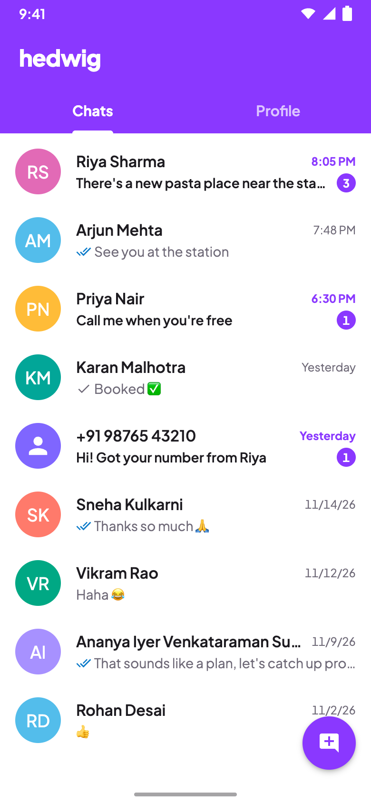
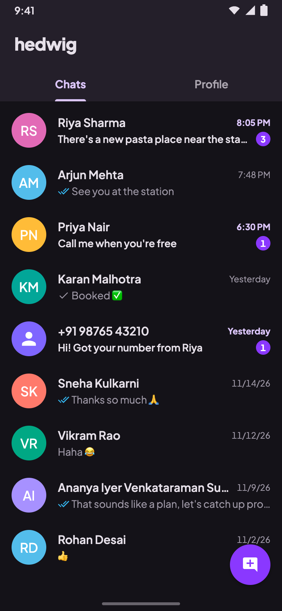
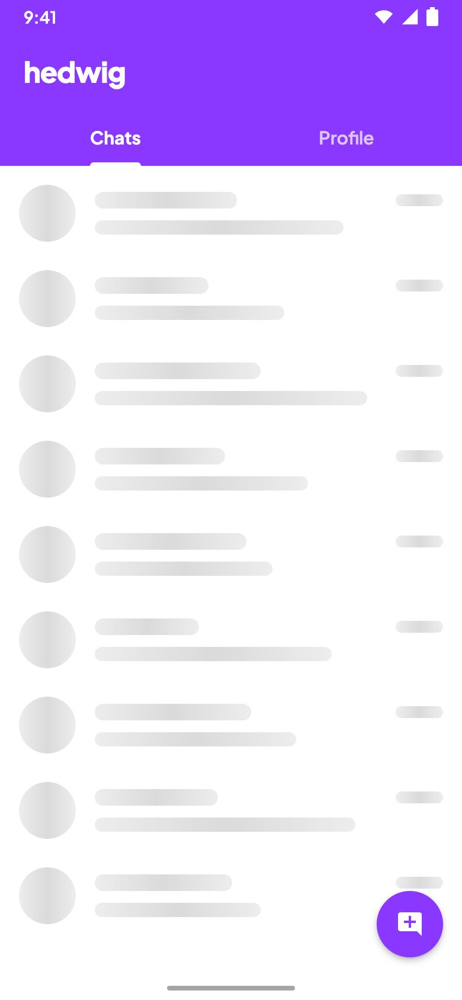

# Chats list mockups

Target design for the Chats tab on Home (Phase 10 UI polish). Phone frame: 390×844, rendered at 2x.
Colors come from `ui/theme/Color.kt`, and the font is Plus Jakarta Sans. The top bar, the tabs and the FAB are the Home shell from `mockups/home/`, unchanged. The rows share their size and avatar with New Chat (`mockups/new-chat/`).

| # | Image | State |
|---|-------|-------|
| 1 | [01-chats-light.png](01-chats-light.png) | Chats with unread, sent and read rows (light) |
| 2 | [02-chats-dark.png](02-chats-dark.png) | The same list (dark) |
| 3 | [03-loading-light.png](03-loading-light.png) | Waiting for the first snapshot (light) |

The empty state ("No chats yet") and the error state keep the shared `EmptyState` from the functional pass.

## 1. Chats



- **Row:** at least 72dp tall, 16dp side padding, a 48dp `Avatar`, then 16dp to the text. It's a custom `Row`, not `ListItem`, so the time and the badge can sit on the two text lines.
  - **Line 1:** the name (16sp / 22sp SemiBold), which takes the remaining width and ellipsizes, then the time (12sp, tabular digits).
  - **Line 2:** a ✓ or ✓✓ for my last message, the message (14sp / 20sp, one line, ellipsized), then the unread badge.
  - The name and the message get the space; the time and the badge are measured first and never move. Look at "Ananya Iyer Venkataraman Su…".
- **Unread rows** stand out three ways, so it doesn't rely on colour alone:
  - the time in `accentText`, Bold
  - the message in the main text colour, SemiBold, instead of `secondaryText`
  - a badge: an `accent` pill, at least 20dp, white 12sp Bold, "99+" above 99
- **Read rows:** the time and the message in `secondaryText`.
- **Ticks:** 16dp, 3dp before the message. Grey ✓ when sent, ✓✓ in `readTick` when read, the same `StatusIcon` as the chat screen. None when the last message is theirs.
- **No name:** the formatted phone number ("+91 98765 43210") and the person icon in the avatar.
- **No dividers,** as in New Chat.
- **TalkBack** reads each row as one item: "Riya Sharma, 8:05 PM, There's a new pasta place…, 3 unread messages".
- **The list's bottom padding is 88dp,** so the last row can scroll clear of the FAB.

## Behaviour (not shown in a still)

- **A new message moves its chat to the top,** and the rows slide into their new places with `Modifier.animateItem()`, instead of jumping.
- **When you're at the top of the list,** you stay at the top and see the chat arrive. By default `LazyColumn` keeps the previously first row in view, which would leave the moved chat just above the screen.

## 2. Dark



- The background is `background` (`#141218`), and the unread time is `accentText` (`#DCC6FB`).
- The read tick is `#34B7F1`, the dark `readTick`.

## 3. Loading



- **Skeleton rows** with the same geometry as a real row: a 48dp circle, a name bar and a time bar on line 1, and a message bar on line 2. The bars have varied widths so it reads like real chats.
- The same `Shimmer` as New Chat and Profile. It replaces the spinner.
- **The FAB stays usable** while loading.

## Source

`source/` has the HTML each image was rendered from, plus the shared `chats.css`. To re-render after an edit:

```sh
"/Applications/Google Chrome.app/Contents/MacOS/Google Chrome" --headless=new --hide-scrollbars \
  --force-device-scale-factor=2 --window-size=390,844 --virtual-time-budget=6000 \
  --screenshot=01-chats-light.png "file://$PWD/source/01-chats-light.html"
```
