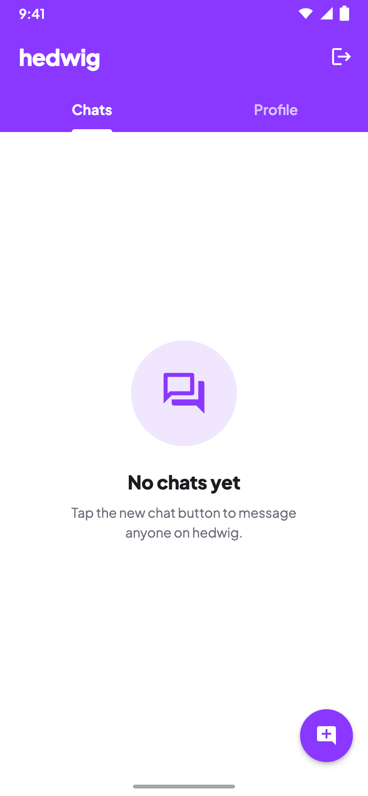
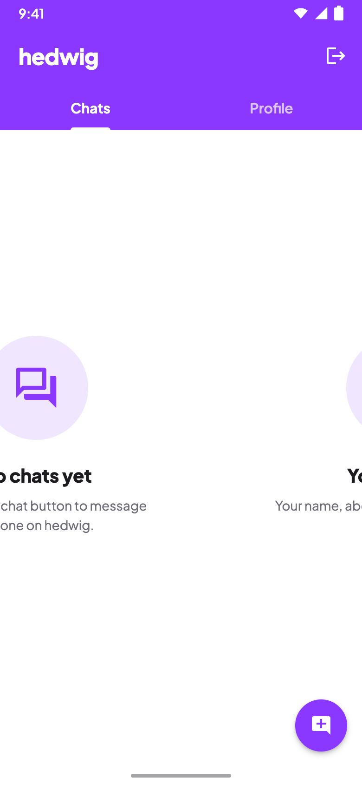
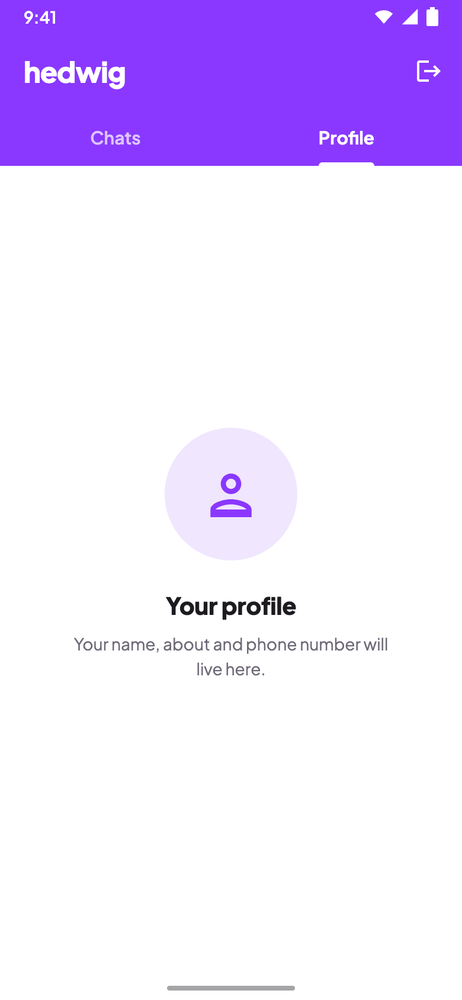
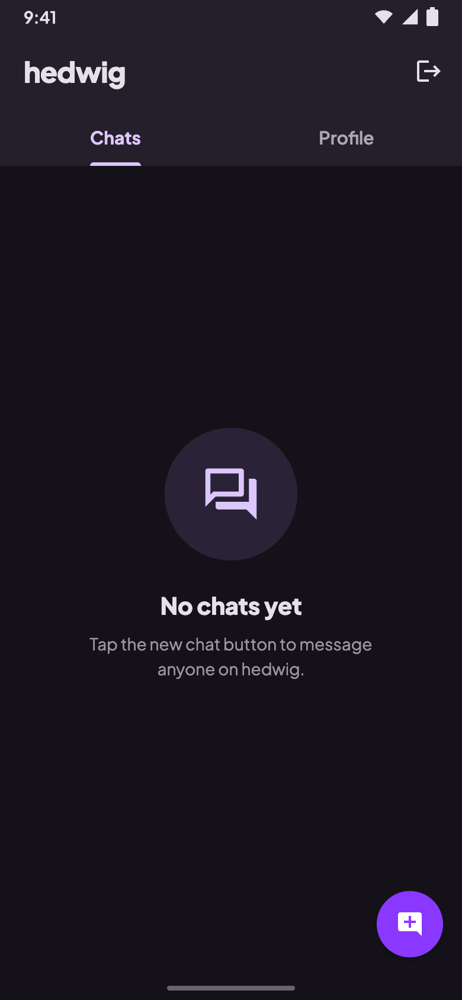

# Home shell mockups

Target design for the Home screen shell (Phase 6 UI polish). Phone frame: 390×844, rendered at 2x.
Colors come from `ui/theme/Color.kt`, and the font is Plus Jakarta Sans. The styling matches the login and profile mocks.

| # | Image | State |
|---|-------|-------|
| 1 | [01-chats-light.png](01-chats-light.png) | Chats tab, no chats yet (light) |
| 2 | [02-swiping-light.png](02-swiping-light.png) | Swiping from Chats to Profile, 40% of the way (light) |
| 3 | [03-profile-tab-light.png](03-profile-tab-light.png) | Profile tab, FAB hidden (light) |
| 4 | [04-chats-dark.png](04-chats-dark.png) | Chats tab (dark) |

## 1. Chats, empty



- **One purple block:** the status bar, app bar and tabs share `topBar`, with no divider. The status bar icons are white (`LightStatusBarIcons`).
- **Title:** "hedwig" as a wordmark: 24sp, ExtraBold, letter spacing -0.5sp, lowercase like the brand.
- **Action:** the logout icon stays until Phase 7 moves logout into the Profile tab.
- **Tabs:** sentence case ("Chats", not "CHATS"), 15sp. The selected tab is Bold and white. The unselected tab is SemiBold at 70% white.
- **Indicator:** 3dp, **as wide as the label** (not the whole tab), with rounded top corners. This is Material 3's `PrimaryIndicator` look.
- **Empty state:** a reusable `EmptyState`, also used on the Profile tab:
  - a 112dp circle in `selectedRow` with a 52dp `Icons.Outlined.Forum` in `accentText`
  - the title "No chats yet" (20sp ExtraBold)
  - one or two lines of body text in `secondaryText`, centred, at most about 270dp wide
  - the group sits a little above centre, because the eye reads the centre of the screen as slightly lower than it is
- **FAB:** a 56dp circle in `accent`, with a white `Icons.Filled.AddComment` (a chat bubble with a plus), so it says "new chat", not just "message". It sits 16dp above the gesture bar.

## 2. Swiping



- **The indicator stays under "Chats":** the pages are 40% of the way to Profile, but the indicator follows `currentPage`, which only flips at the halfway point. It then slides across with `tabIndicatorOffset`'s built-in animation.
- **A finger-following indicator was considered and dropped.** It would need a custom `tabIndicatorLayout` driven by `currentPageOffsetFraction`, and that code depends on `TabRow` internals. It isn't worth that for a 3dp bar.
- **Label colour** also switches at the halfway point, so "Chats" stays selected here.
- **FAB:** still showing, because `currentPage` is still Chats. It fades out when the swipe passes halfway.

## 3. Profile tab



- **No FAB:** "New chat" only makes sense on Chats.
- **Placeholder:** the same `EmptyState` with `Icons.Outlined.Person`. Phase 7 replaces it with the real profile.

## 4. Chats (dark)



- **Top bar `#241F2A` (`SurfaceHighDark`):** this replaces the WhatsApp slate `DarkSlate200` (`#232D36`). That slate is blue-grey and clashes with hedwig's purple-tinted dark neutrals. The new tone is one step above `panel` (`#1D1A22`), so the bar still separates from the `#141218` background.
- **Bar text** `#E6E0E9` (`TextDark`), with the selected tab and indicator in `#DCC6FB` (`accentText`).
- **Empty-state circle** `SelectedDark` (`#2A2236`), icon `#DCC6FB`.
- **FAB:** the same purple as in light mode.

## Source

`source/` has the HTML each image was rendered from, plus the shared `home.css`. Open one in a browser to inspect sizes and colors. Each page's `.tabs` has a `data-progress` attribute (0 = Chats, 1 = Profile), and a small script places the indicator under that label. To re-render after an edit:

```sh
"/Applications/Google Chrome.app/Contents/MacOS/Google Chrome" --headless=new --hide-scrollbars \
  --force-device-scale-factor=2 --window-size=390,844 --virtual-time-budget=6000 \
  --screenshot=01-chats-light.png "file://$PWD/source/01-chats-light.html"
```
