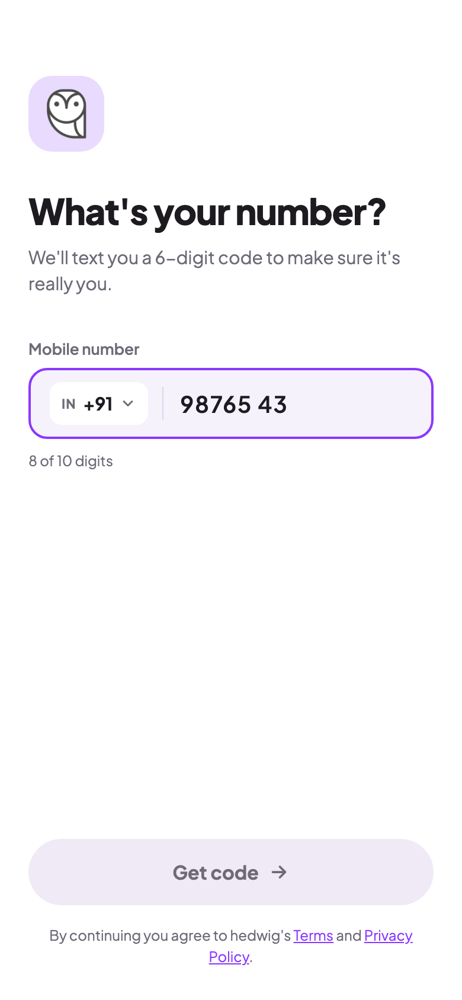
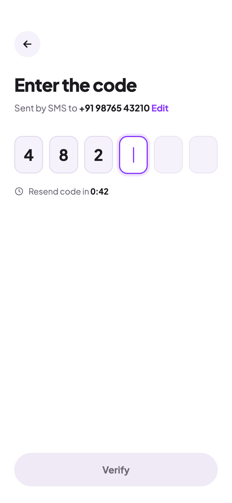
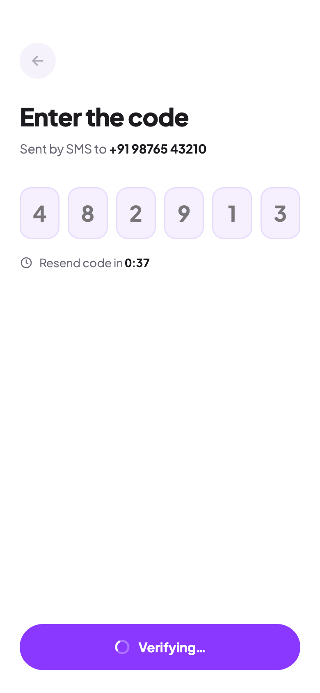
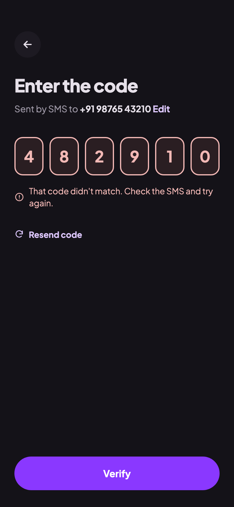
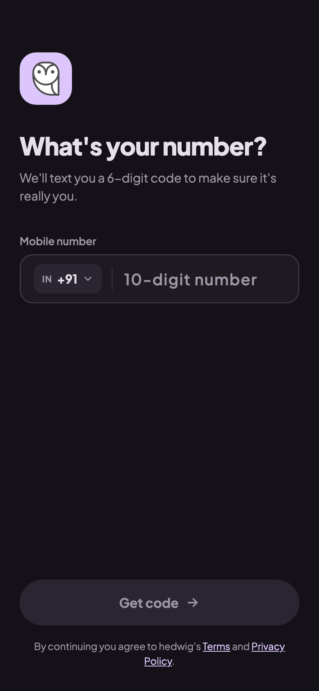

# Login redesign mockups

Target design for the login screen (Phase 4 UI polish). Phone frame: 390×844, rendered at 2x.
Colors come from `ui/theme/Color.kt`, and the font is Plus Jakarta Sans.

| # | Image | State |
|---|-------|-------|
| 1 | [01-phone-light.png](01-phone-light.png) | Phone step, number half typed (light) |
| 2 | [02-code-light.png](02-code-light.png) | Code step, 3 of 6 digits typed (light) |
| 3 | [03-verifying-light.png](03-verifying-light.png) | Verifying the code (light) |
| 4 | [04-wrong-code-dark.png](04-wrong-code-dark.png) | Wrong code entered (dark) |
| 5 | [05-phone-empty-dark.png](05-phone-empty-dark.png) | Phone step, empty (dark) |

## 1. Phone step, half typed



- **Header:** a 64dp owl tile (`HedwigPurpleLight` background, 20dp corners), then a large left-aligned title and a gray subtitle. The header is shared by both steps.
- **Field:** a rounded outlined field (16dp corners, `panel` fill, 2dp purple border when focused). An `IN +91 ⌄` chip sits in the leading slot.
- **Number display:** shown as `98765 43` through a `VisualTransformation`; the state stays plain digits.
- **Counter:** "8 of 10 digits" in the field's supporting text.
- **Button:** a disabled "Get code" button, full width, 56dp tall, pill shaped, pinned to the bottom (it rides above the keyboard with `imePadding`).
- **Legal line:** Terms / Privacy line under the button.

## 2. Code step, partly typed



- **Back:** a round 44dp back button. It does the same as "Edit" and the system back gesture (`BackHandler`).
- **Subtitle:** "Sent by SMS to **+91 98765 43210** Edit", where **Edit** calls `editMobileNumber()`.
- **Code boxes:** six boxes drawn by one `BasicTextField`'s `decorationBox`:
  - filled boxes have a tinted fill
  - the active box (index == `otp.length`) has a purple border, a soft focus ring and a blinking cursor
  - empty boxes are plain
- **Resend row:** "Resend code in 0:42" as plain text with a clock icon, using tabular digits (`fontFeatureSettings = "tnum"`).
- **Button:** "Verify" is disabled until all 6 digits are in.

## 3. Verifying (inline loading)



- **Button:** shows a small white spinner and "Verifying…" instead of a full-screen gray overlay. This is the `loading` state of a reusable `PrimaryButton`.
- **Inputs:** the boxes are dimmed and the back button is disabled (`enabled = !isLoading`), so nothing can change mid-request.
- **Edit link:** hidden while verifying.

## 4. Wrong code (dark)



- **Boxes:** all six get the error color (`MaterialTheme.colorScheme.error`) for border and digits, on a dark red tint.
- **Error message:** shown right under the boxes with an alert icon, not at the bottom of the screen.
- **Resend:** the countdown has finished, so the row becomes a tappable "Resend code" (`accentText`, `#DCC6FB` in dark mode).
- **Optional polish:** a horizontal shake (`Animatable` plus `Modifier.offset`), started from `LaunchedEffect(errorMessage)`, and `HapticFeedbackType.Reject`.

## 5. Phone step, empty (dark)



- **Dark tokens:** shows the dark theme with nothing typed:
  - background `#141218`
  - field `SurfaceDark` with a subtle border
  - placeholder "10-digit number"
- **Button:** disabled "Get code" in the dark disabled colors.
- **Owl tile:** uses `HedwigLauncherBg` in dark mode.

## Between the steps

The phone and code steps slide horizontally with `AnimatedContent`: forward goes left, and Edit or back goes right.

## Source

`source/` has the HTML each image was rendered from. Open one in a browser to inspect sizes and colors. To re-render after an edit:

```sh
"/Applications/Google Chrome.app/Contents/MacOS/Google Chrome" --headless=new --hide-scrollbars \
  --force-device-scale-factor=2 --window-size=390,844 --virtual-time-budget=6000 \
  --screenshot=01-phone-light.png "file://$PWD/source/01-phone-light.html"
```
