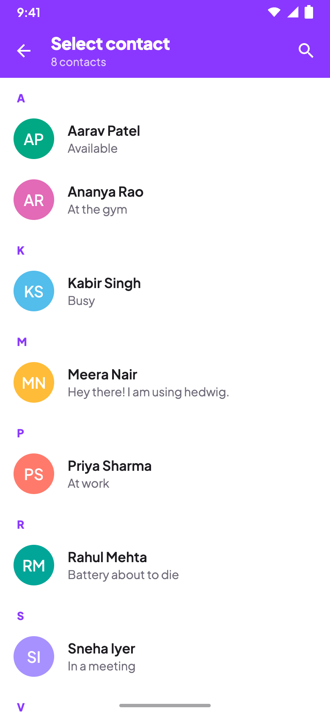
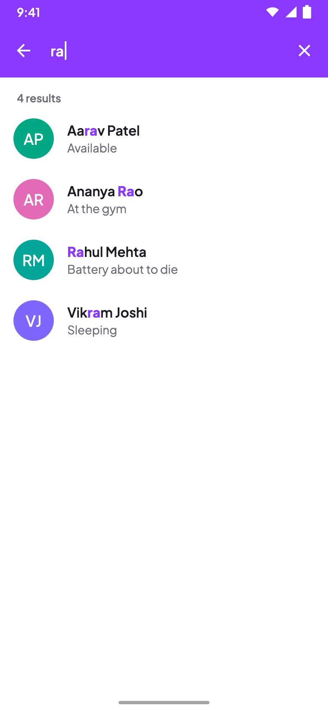
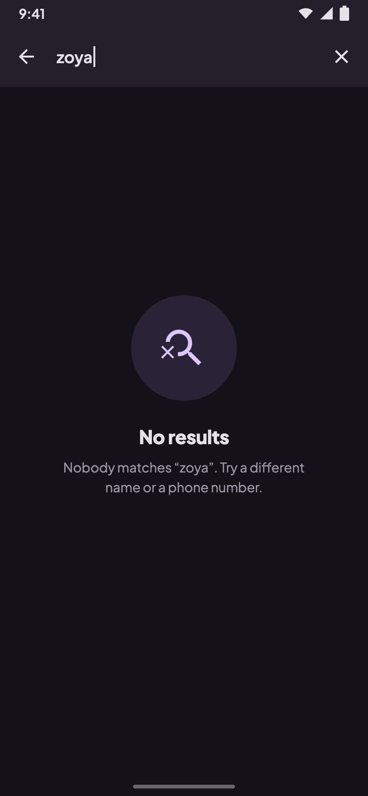
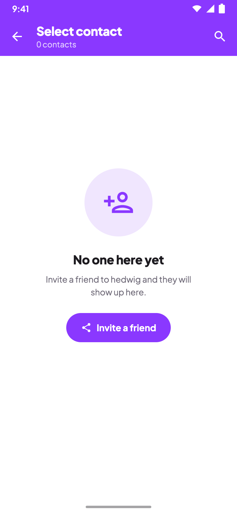
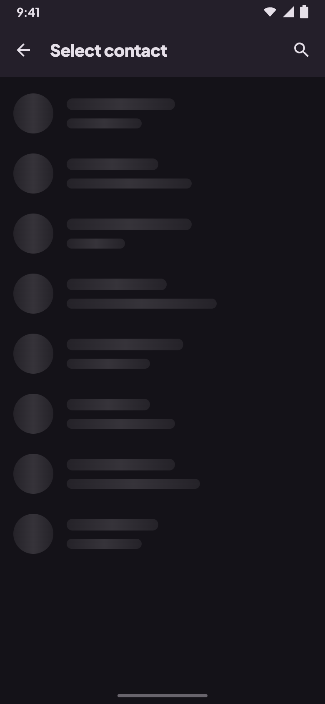

# New chat mockups

Target design for the New chat contact picker (Phase 8 UI polish). Phone frame: 390×844, rendered at 2x.
Colors come from `ui/theme/Color.kt`, and the font is Plus Jakarta Sans. The top bar matches Home.

| # | Image | State |
|---|-------|-------|
| 1 | [01-contacts-light.png](01-contacts-light.png) | Contact list with letter headers (light) |
| 2 | [02-search-light.png](02-search-light.png) | Searching "ra", matches highlighted (light) |
| 3 | [03-no-results-dark.png](03-no-results-dark.png) | Search with no matches (dark) |
| 4 | [04-empty-light.png](04-empty-light.png) | Nobody else has signed up yet (light) |
| 5 | [05-loading-dark.png](05-loading-dark.png) | Waiting for the first Firestore snapshot (dark) |

## 1. Contacts



- **Top bar:** the back arrow, then the title "Select contact" (20sp ExtraBold, like the wordmark) over the count "8 contacts" (13sp at 75% `onTopBar`, tabular digits), then search.
- **Letter headers:** contacts are grouped by the first letter of their name.
  - Each header is 13sp ExtraBold in `accentText`, on the screen background.
  - The headers are **sticky**: the current letter stays pinned under the top bar while its group scrolls, then the next letter pushes it out.
- **Rows:** 72dp, a 48dp `Avatar`, the name in 16sp SemiBold, and the about in 14sp `secondaryText` on one ellipsized line.
  - No dividers. The headers and spacing already separate the rows, as in WhatsApp and Contacts.

## 2. Search



- **Search mode:**
  - The title becomes the field, with the cursor showing.
  - The back arrow closes search.
  - The ✕ clears the text.
- **Flat results:** no letter headers while searching. A small "4 results" label replaces them, so the count is still visible.
- **Highlighting:** the part of each name that matches the query is drawn in `accentText` ExtraBold (`AnnotatedString` with a `SpanStyle`). This shows *why* each result matched.

## 3. No results (dark)



- **Empty state:** the shared `EmptyState` with `Icons.Outlined.SearchOff`.
- **Message:** quotes the query and suggests what to try next ("a different name or a phone number").

## 4. No one here yet



- **Empty state:** `EmptyState` with `Icons.Outlined.PersonAdd` and a new **action**: an "Invite a friend" button with a share icon.
- **The button** opens Android's share sheet (`Intent.ACTION_SEND`) with an invite message.
  - It turns a dead end into something the user can act on.
  - It's why `EmptyState` gets an optional `action` slot now. In Phase 6 we deferred that until a screen needed it.

## 5. Loading (dark)



- **Skeleton:** shimmer rows with the same height and padding as `ContactRow`. That means a 48dp circle, plus two bars of varied widths so it reads like real names.
- **Top bar:** shows only the title. The count appears once there is a number to show.

## Source

`source/` has the HTML each image was rendered from, plus the shared `new-chat.css`. To re-render after an edit:

```sh
"/Applications/Google Chrome.app/Contents/MacOS/Google Chrome" --headless=new --hide-scrollbars \
  --force-device-scale-factor=2 --window-size=390,844 --virtual-time-budget=6000 \
  --screenshot=01-contacts-light.png "file://$PWD/source/01-contacts-light.html"
```
