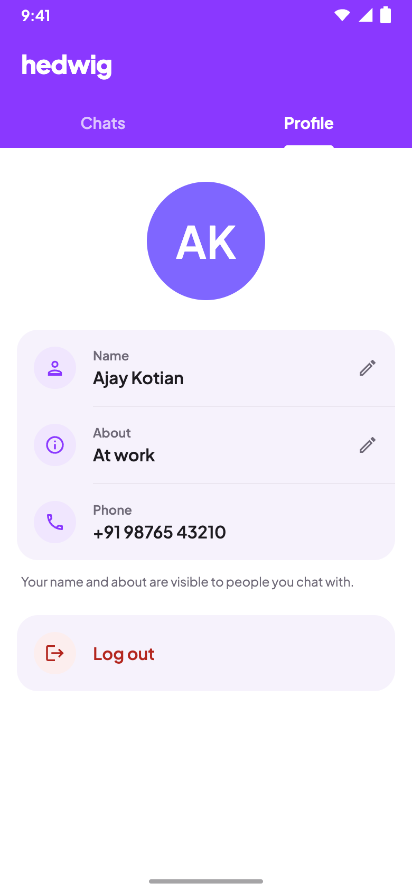
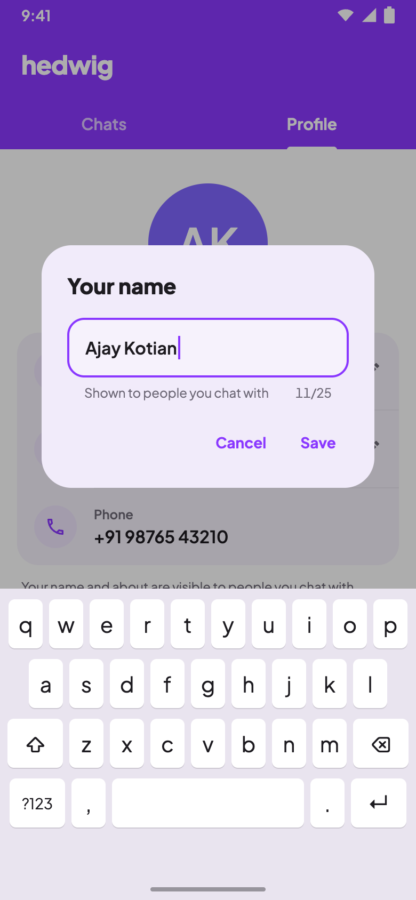
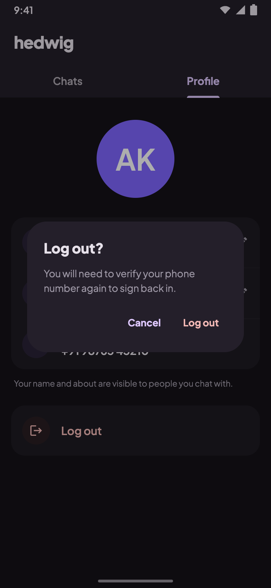
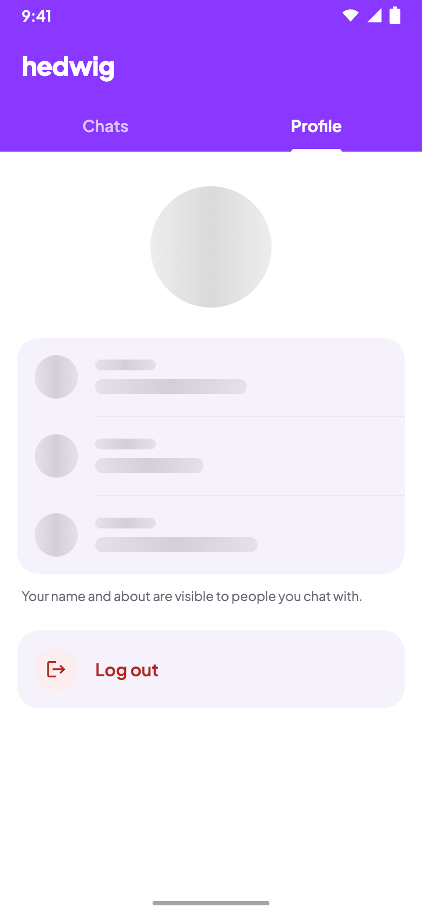
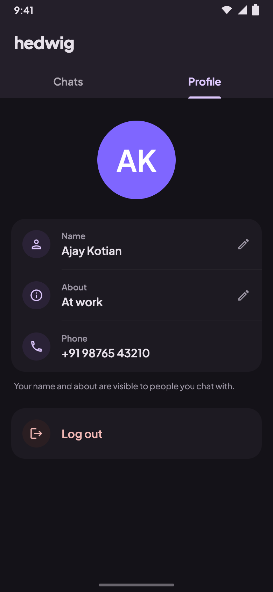

# Profile tab mockups

Target design for the Profile tab on Home (Phase 7 UI polish). Phone frame: 390×844, rendered at 2x.
Colors come from `ui/theme/Color.kt`, and the font is Plus Jakarta Sans. The top bar is the same as in `../home/`.

| # | Image | State |
|---|-------|-------|
| 1 | [01-profile-light.png](01-profile-light.png) | Profile loaded (light) |
| 2 | [02-edit-name-light.png](02-edit-name-light.png) | Editing the name, keyboard open (light) |
| 3 | [03-logout-confirm-dark.png](03-logout-confirm-dark.png) | Log out confirmation (dark) |
| 4 | [04-loading-light.png](04-loading-light.png) | Waiting for the first Firestore snapshot (light) |
| 5 | [05-profile-dark.png](05-profile-dark.png) | Profile loaded (dark) |

## 1. Profile



- **Avatar:** 112dp, centred, 32dp below the tabs. No name under it, because the Name row right below already shows it.
- **Info card:** the Name, About and Phone rows are grouped in one `panel` card (20dp corners, 16dp side margins). It's the same card language as the profile setup preview card.
  - **Each row** is still a `ListItem`, with a transparent container so the card colour shows through.
  - **Leading icon:** sits in a 40dp circle (`selectedRow` fill, `accentText` icon), like the empty states.
  - **Text:** the label is 12sp SemiBold in `secondaryText`, and the value 16sp SemiBold.
  - **Edit pencil:** a trailing pencil in `secondaryText` on Name and About only. Phone isn't editable.
  - **Dividers:** inset 72dp (16 + 40 + 16), so they line up with the text.
- **Phone is formatted:** `+91 98765 43210`, not the raw `+919876543210`.
- **Footnote:** "Your name and about are visible to people you chat with.", in 12sp `secondaryText` under the card. It replaces the hint the reference app put inside the Name row.
- **Log out:** its own card, 24dp below, so a destructive action never sits next to the edit rows. The icon circle is `error` on a light error tint, and the text is `error`.

## 2. Editing the name



- **Dialog:** still Material's `AlertDialog`: 28dp corners on `surfaceContainerHigh`, with a scrim.
  - The title "Your name" is 20sp ExtraBold, matching the `EmptyState` title.
- **Field:** uses the shared `HedwigTextFieldDefaults` (16dp corners, `panel` fill, 2dp `accent` border when focused). It's the same field as Login and Profile setup.
- **Opens ready to type:** the field is focused, the keyboard is up, and **the cursor is at the end** of the current name. That needs `TextFieldValue` with an explicit selection.
- **Supporting row:** the hint on the left and the counter (tabular digits) on the right, as in Profile setup.
- **Keyboard actions:** Done saves, the same as tapping Save. The dialog moves up above the keyboard by itself.
- **Buttons:** `TextButton`s in `accentText`. Save is disabled while the field is blank.

## 3. Log out confirmation (dark)



- **Why confirm:** logging out is costly to undo. The user needs a new OTP, which takes time and an SMS. A one-tap destructive action deserves a confirmation step.
- **Copy:** the title "Log out?" and the body "You will need to verify your phone number again to sign back in."
- **Buttons:** Cancel (`accentText`) and **Log out** in `error`, so the destructive choice is visually distinct.
- **Dark tokens:** dialog `#241F2A` (`surfaceContainerHigh`), error `#F2B8B5`.

## 4. Loading



- **Skeleton, not a spinner:** the same `Shimmer` as Profile setup.
  - a shimmer circle in place of the avatar
  - a shimmer icon circle plus two bars in each row
  - the card and dividers stay, so nothing jumps when data arrives
- **Log out stays usable while loading:** signing out doesn't depend on Firestore. If the profile never loads (offline with an empty cache), the user can still leave.
- **The footnote stays visible.** It is fixed text, not profile data, and keeping it means the Log out card does not move when the data arrives.

## 5. Profile (dark)



- **Dark tokens:**
  - card `#1D1A22` (`panel`)
  - icon circles `#2A2236` (`selectedRow`) with `#DCC6FB` icons
  - dividers `#252229` (`divider`)
  - the Log out tint `#2A1E22`

## Source

`source/` has the HTML each image was rendered from, plus the shared `profile-tab.css`. To re-render after an edit:

```sh
"/Applications/Google Chrome.app/Contents/MacOS/Google Chrome" --headless=new --hide-scrollbars \
  --force-device-scale-factor=2 --window-size=390,844 --virtual-time-budget=6000 \
  --screenshot=01-profile-light.png "file://$PWD/source/01-profile-light.html"
```
