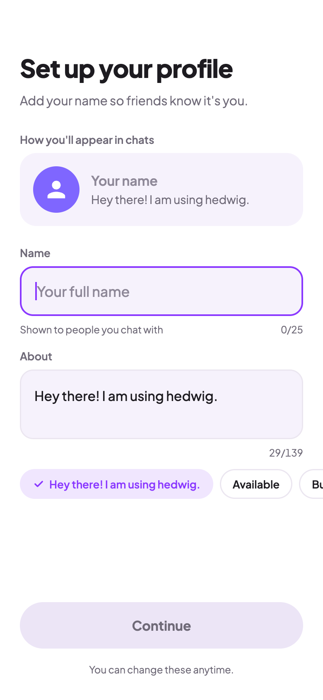
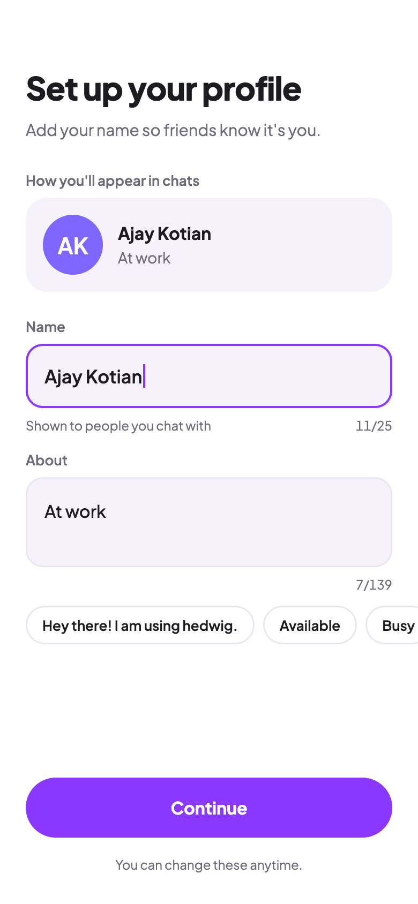
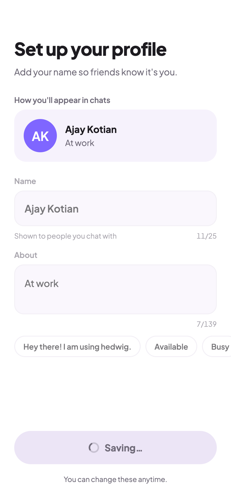
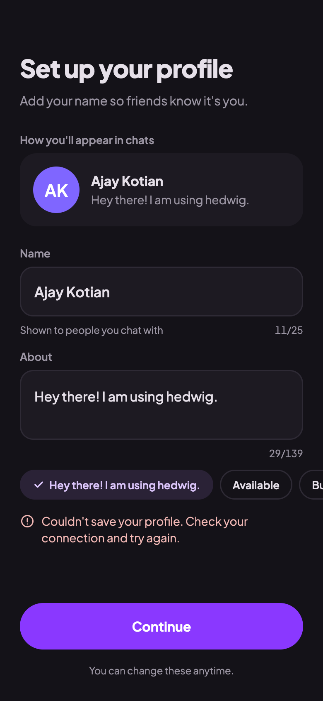
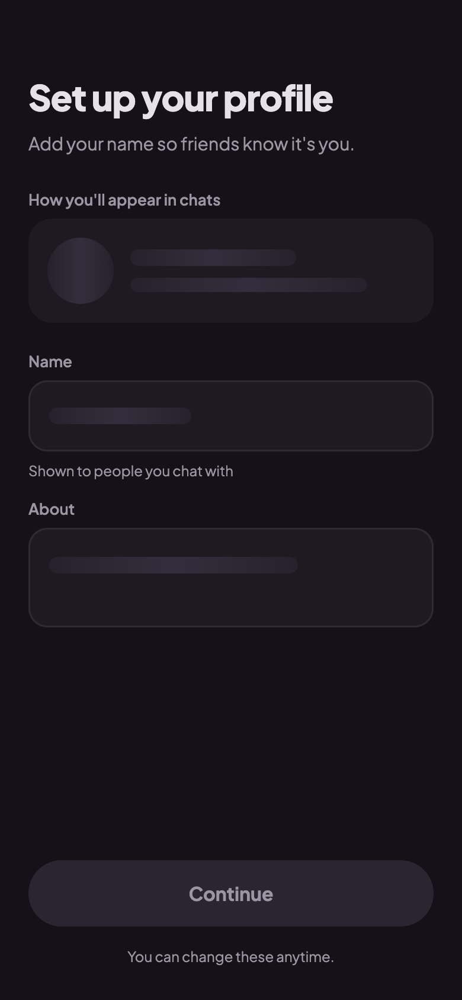

# Profile setup mockups

Target design for the profile setup screen (Phase 5 UI polish). Phone frame: 390×844, rendered at 2x.
Colors come from `ui/theme/Color.kt`, and the font is Plus Jakarta Sans. The styling matches the login mocks in `../login/`.

| # | Image | State |
|---|-------|-------|
| 1 | [01-empty-light.png](01-empty-light.png) | New user, nothing typed yet (light) |
| 2 | [02-typing-light.png](02-typing-light.png) | Name typed, "At work" preset picked (light) |
| 3 | [03-saving-light.png](03-saving-light.png) | Saving the profile (light) |
| 4 | [04-error-dark.png](04-error-dark.png) | Save failed (dark) |
| 5 | [05-loading-dark.png](05-loading-dark.png) | Waiting for the first Firestore snapshot (dark) |

## 1. New user, empty



- **Header:** the same `StepHeader` as login, with no owl tile. The preview card below plays the hero role.
- **Preview card:** "How you'll appear in chats", with a `panel` card (20dp corners) laid out like a chat list row:
  - a 56dp `Avatar`
  - the name in bold
  - the about text in one ellipsized line

  With no name yet, the avatar shows the person icon and the name shows "Your name" in the muted color.
- **Fields:** a label above each field (13sp semibold, secondary color), as on the login phone step.
  - Both fields use the login field style: 16dp corners, `panel` fill, a 2dp `accent` border when focused, `outlineVariant` when not.
  - The name field gets focus automatically for a new user.
- **Supporting row:** a hint on the left ("Shown to people you chat with") and a counter on the right (`0/25`) using tabular digits.
- **About presets:** a row of chips under About. Tapping one fills the About field. The chip that matches `aboutDraft` is selected (a tinted fill and a check). The row scrolls horizontally. In the mock it runs off the right edge of the screen; the app stops it at the 24dp padding, because `verticalScroll` clips sideways overflow. A chip cut off at the padding still shows that the row scrolls.
- **Button:** "Continue" stays disabled until the name isn't blank. Below it, the hint "You can change these anytime."

## 2. Typing



- **Live preview:** the card updates on every keystroke. The avatar shows initials ("AK"), and the about line follows the field. Nothing is synced by hand; both read the same drafts from `ProfileUIState`.
- **Presets:** picking "At work" replaced the About text and moved the check to that chip.
- **Button:** enabled.

## 3. Saving



- **Button:** `PrimaryButton` in its loading state, gray with a spinner and "Saving…". This is the same look you chose for login.
- **Inputs:** fields, labels and chips are dimmed and disabled (`enabled = !isSaving`). The preview card stays at full strength, because it's the thing being saved.

## 4. Save failed (dark)



- **Error row:** shown under the chips with an alert icon. It reuses the login `ErrorRow`, moved to `ui/components/`.
- **Button:** enabled again, so tapping Continue retries.
- **Dark tokens:**
  - background `#141218`
  - `panel` `#1D1A22`
  - selected chip `SelectedDark` with `accentText` `#DCC6FB`
  - error `#F2B8B5`

## 5. Loading (dark)



- **Layout:** while `isLoading`, the screen keeps its real layout. The avatar, text lines and field contents are replaced by skeleton "bones" with a shimmer gradient sweeping across them.
- **Why a skeleton:** it avoids the jump from an empty form to a filled one. It's usually on screen for a split second, because Firestore answers from the local cache.
- **Chips and counters:** hidden until the data arrives. The button is disabled.

## Source

`source/` has the HTML each image was rendered from, plus the shared `profile.css`. Open one in a browser to inspect sizes and colors. To re-render after an edit:

```sh
"/Applications/Google Chrome.app/Contents/MacOS/Google Chrome" --headless=new --hide-scrollbars \
  --force-device-scale-factor=2 --window-size=390,844 --virtual-time-budget=6000 \
  --screenshot=01-empty-light.png "file://$PWD/source/01-empty-light.html"
```
